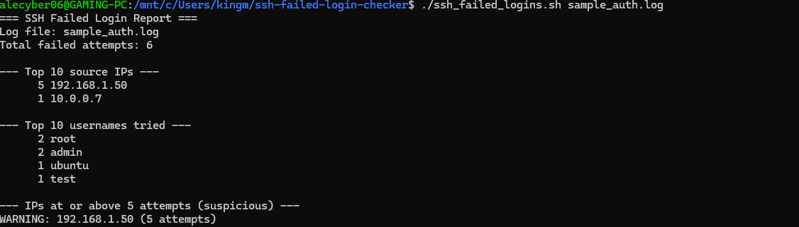
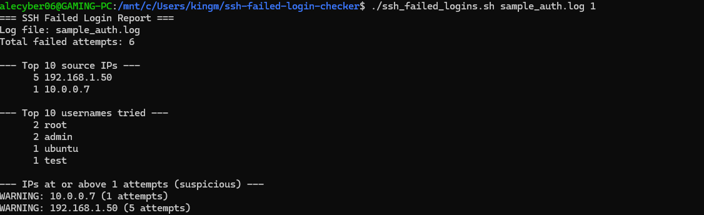

# SSH Failed Login Checker

A small Bash tool that scans a Linux auth log for failed SSH logins, shows which IP addresses and usernames are getting hit the most, and flags IPs that look like brute-force attempts.

I built this as part of my cybersecurity studies to practice Linux command-line skills and to learn what attacks actually look like in real logs.

## Why I Made This

Any server with SSH open to the internet gets hammered by bots trying common usernames and passwords. Spotting that pattern is one of the first things a security analyst does. I wanted to build a simple tool that does it automatically instead of scrolling through thousands of log lines by hand.

## What It Does

- Counts total failed SSH login attempts
- Lists the top 10 source IP addresses
- Lists the top 10 usernames attackers tried (like `root`, `admin`, `test`)
- Flags any IP that hits a set number of failed attempts (default is 5)

## Requirements

- Linux (tested on Ubuntu) or WSL on Windows
- Bash
- Standard tools: `grep`, `awk`, `sed`, `sort`, `uniq`
- Permission to read the log file (usually needs `sudo` for `/var/log/auth.log`)

## Setup

```bash
git clone https://github.com/alecyber06/ssh-failed-login-checker.git
cd ssh-failed-login-checker
chmod +x ssh_failed_logins.sh
```

## Usage

```bash
./ssh_failed_logins.sh [log_file] [threshold]
```

Both options are optional:

- `log_file`: path to the log (default: `/var/log/auth.log`)
- `threshold`: number of failed attempts before an IP gets flagged (default: 5)

Examples:

```bash
# Scan the real system log
sudo ./ssh_failed_logins.sh

# Scan the real log, flag IPs with 3 or more failures
sudo ./ssh_failed_logins.sh /var/log/auth.log 3

# Try it on the included sample log
./ssh_failed_logins.sh sample_auth.log
```

If your system doesn't have `/var/log/auth.log` (some newer Ubuntu setups), export the SSH logs first and point the script at that file:

```bash
journalctl -u ssh > sshlog.txt
./ssh_failed_logins.sh sshlog.txt
```

## Sample Output

Running it on the included sample log:



Lowering the threshold to 1 flags both IPs:



## How It Works

1. `grep` pulls out only the lines containing "Failed password"
2. `grep -oE` and `awk` extract the IP address from each line
3. `sort | uniq -c | sort -rn` counts how many times each IP or username appears, biggest first
4. `sed` strips each line down to just the username
5. `awk` compares each IP's count to the threshold and prints a warning if it's at or above it

## Testing

The repo includes `sample_auth.log`, a fake log with made-up failed logins, so you can try the script without needing a real server or a real attack. It contains no real IPs, usernames, or passwords.

## What I Learned

- How to read and filter log files with command-line tools
- How `sort | uniq -c | sort -rn` works as a quick counting pattern
- How to pass arguments into a Bash script and set default values
- What brute-force login attempts look like (lots of tries on common usernames like `root` and `admin` from the same IP)
- How to use `sed` and regular expressions to pull specific pieces out of messy text
- How to document a project so someone else can run it

## Limitations

- Only catches IPv4 addresses, not IPv6
- Only looks for "Failed password" lines, so it misses other failure types like invalid keys
- Reports on a log after the fact, it doesn't watch live or block anything
- Log formats vary between Linux distros, so the patterns may need tweaking
- Prints "1 attempts" instead of "1 attempt" when an IP has a single failure

## Future Improvements

- IPv6 support
- Export the report to a CSV or text file
- Show timestamps so you can see when attacks started and stopped
- Add geolocation lookups for flagged IPs
- Suggest `fail2ban` rules for flagged IPs
- Fix singular/plural wording in the warning output
- Write a PowerShell version for Windows Event ID 4625 (failed logons)

## Security Note

This tool only reads logs, it never changes anything on the system. If you use it on real logs, don't commit those logs to a public repo, since they can contain real IP addresses and usernames.

## Author

Ale, cybersecurity student at Florida International University
[LinkedIn](#) | [GitHub](#)
